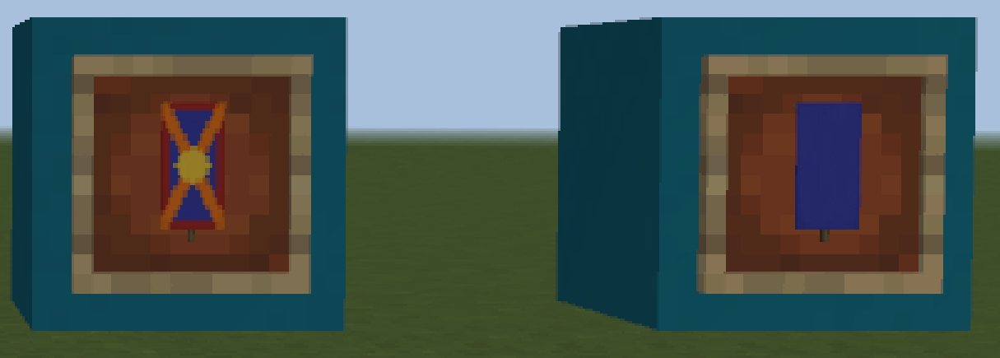
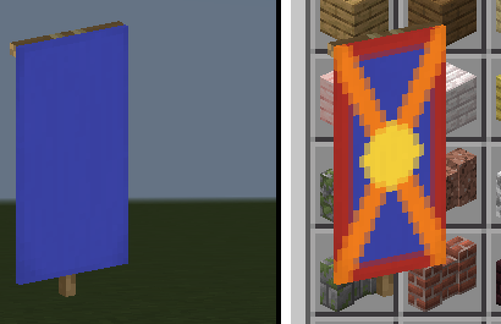
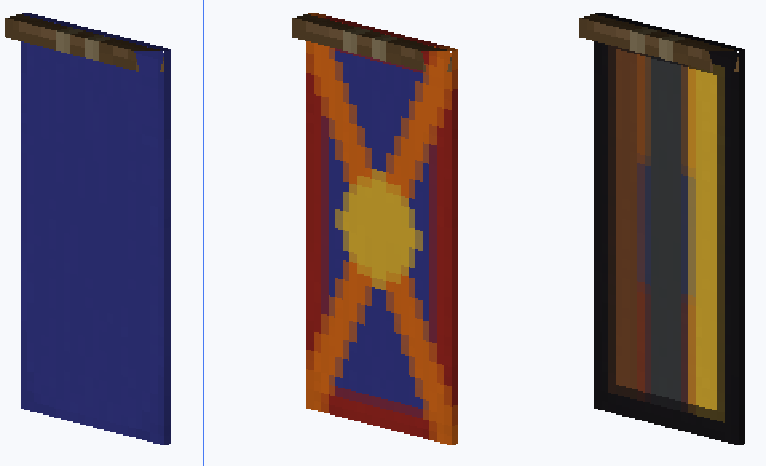
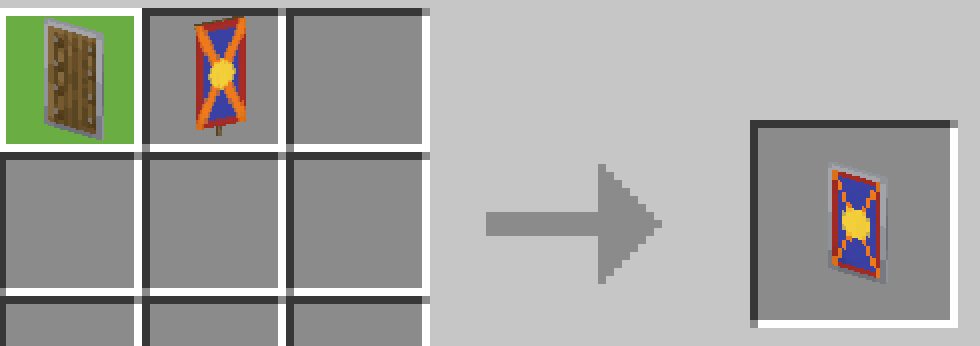

# Native Banner Item And Patterned Shield

NEMC 3.10.0.420447 / Minecraft 1.21.130.0. This package records bounded
feasibility research. No product renderer or qualification gate is enabled.

## Result

Native banner base colors and ordered patterns can be retained. Independently
rotatable wall-banner block geometry is visible in the actual editor, but its
silhouette differs from the actual banner item. It is not an accepted item
renderer. Patterned shields are still unresolved: native crafting previews
are visually correct, while authentic output userdata has not been obtained.

The v5 standing-banner comparison did not produce a usable geometry image.
It cannot establish that standing-banner geometry matches the item. The
current evidence does not qualify direct native item integration; a separate
item geometry adapter or a further native item route is still required.

## Item And Block Are Different

Actual world frames filled through PlayerUseItemToPos show a short central
stalk below the cloth. The full original v1 screenshot also has raw Combine
copies whose frame bodies are visible but contents are absent. The crop here
contains only the actual populated frames. This nearly frontal reference is
too small to qualify exact item thickness or six-face placement.

Native SetUiItem also preserves the stalk, blue base and ordered pattern
colors. Its success qualifies userdata preservation in an inventory control;
it does not qualify arbitrary rotation or shared scene depth.

The v3 candidate uses wall_banner with bannerIsStanding=False. It has a
prominent horizontal top rod and cloth side thickness, but lacks the item's
lower central stalk. Rotating or rescaling cannot add the missing pole.
The 0/3/6-layer patterns are retained without handmade texture composition.
The three raw controls were isolated from the main stone-only document, so
their visible flags were independent controls rather than main-scene flags.

[v3/final-report.json](v3/final-report.json) records front, oblique and back
evidence, exact source identity and restoration. Common depth, clipping,
six frame faces/eight rotations, exact item silhouette/scale/thickness,
full/missing world projection, opacity, lifecycle acceptance and type-1
ominous banners remain open. A native item reference must be used for any
future geometry adapter.

## V5 Cold Comparison

The actual [front frame reference](v5/native-frame-front.png) shows both
native items with short lower stalks. The [oblique frame reference](v5/native-frame-oblique.png)
shows frame bodies but no contents, so it is not a thickness positive.
The three standing-pattern, wall-pattern and standing-plain block controls
returned True but collapsed to near-pixel lines in both the
[front](v5/editor-standing-front.png) and [oblique](v5/editor-standing-oblique.png)
images. The right-hand native inventory item remains visible; this v5
payload rendered plain blue, unlike the patterned v1 positive. The native
item control does not establish an arbitrarily rotatable scene renderer.

A final adjacent transparent-state packet calibration also returned True,
but the next WGC was rejected because foreground changed. Its
[rejected saved image](v5/rejected-editor-packet-front.png) is a 95-percent
loading screen, not a successful comparison. A missing state packet remains
an unconfirmed explanation for the collapsed controls.

[final-report.json](v5/final-report.json) retains those limits. World cells,
inventory, camera, the original editor/workspace, all temporary controls and
HUD were restored and checked. The exact MC process then exited with
0xC0000409 during normal-only stop; MCDK exited with 0. This is an abnormal
game exit. No force was used. All accepted capture receipts and all full
images needed to review v1/v3/v4/v5 are included in this package.

## Shield Data Comparison

The actual native recipe preview shows the blue patterned shield. Synthetic
Base/aux candidates showed colored pattern layers over white, so they are
not accepted as a serialization contract.

The v4 controlled comparison used one plain shield and an aux-4 blue banner
with bo/1, cr/14, mc/11 layers. The nine workbench inputs and complete
36-slot inventory were journaled before mutation. The input banner readback
contained the expected typed Pattern/Color compounds.

1. [baseline-read.json](v4/baseline-read.json) records the default shield
   preview event without userData.
2. [listener-optin.json](v4/listener-optin.json) records removal of that
   listener, GetUserDataInEvent('CraftUpdateResultItemClientEvent') returning
   True, and re-registration afterward. The native wrapper's full docstring
   is retained. The request happened before the second listener registration.
3. [air-read.json](v4/air-read.json) proves a fresh empty result after removing
   the banner, then [optin-read.json](v4/optin-read.json) proves the fresh
   shield result after restoring that exact banner. It still has no userData.
4. The opt-in crafting screenshot was actually viewed and the blue patterned
   native result remained correct. Its original image/hash/WGC identity is
   referenced by [the capture receipt](v4/optin-crafting.capture.json).

This closes the runtime opt-in plus re-registration experiment for this
event. Cold initialization timing and actual output acquisition remain
untested; the result does not establish that every item-data API fails.
No crafted output was taken and no desktop input was sent.

## Native Resource Facts

[resource-contract.json](resource-contract.json) hashes ten exact installed
resources and preserves only the relevant shield/controller/geometry and
pattern-shader excerpts. The shield attachable declares pattern and
pattern_glint using atlas.shield. The render controller reads
variable.is_patterned and variable.is_enchanted. The inspected shield JSON
does not assign is_patterned or map it to a query/NBT key; the native engine
supplies it.

pattern.fragment consumes PATTERN_COUNT, PATTERN_COLORS and
PATTERN_UV_OFFSETS_AND_SCALES. It samples the default shield texture at
TEXTURE_0 and successive atlas layers at TEXTURE_2, mixing them in order.
This is evidence of a native patterned render route, not evidence that a
specific guessed Base field is correct. The equipped shield geometry has a
board and handle, but it does not establish inventory/frame item pose.

The minimum preferred route is authentic native output data followed by
native item rendering. A fallback would need independently verified shield
geometry, atlas UV/base layer mapping, depth, glint and frame transforms.
Putting a wall-banner control on a board does not qualify that fallback.

## Restoration And Exit

[craft-cleanup.json](v4/craft-cleanup.json) verifies all nine input slots
restored exactly and the complete inventory unchanged. The exact listener
was unregistered and its global deleted; [hud-verify.json](v4/hud-verify.json)
confirms HUD and temporary-global absence. No undo API for the engine event
opt-in is documented, so the dedicated owned game was closed afterward.

Normal-only stop timed out. A later read-only check matched both exact
creation identities and read MC exit code **0xC0000409**, MCDK exit code 0.
The MC exit is abnormal and is not described as normal shutdown. No force
was used. The already-exited session was then finalized as stopped. See
[lifecycle-read.json](v4/lifecycle-read.json),
[stop-final.json](v4/stop-final.json), and
[final-report.json](v4/final-report.json).

[manifest.json](manifest.json) records all packaged file hashes, crop bounds,
nearest-neighbor scaling and original evidence references. All four crops
and the new v4 full screenshot were actually viewed. Original capture
receipts retain fresh WGC timestamps and foreground preservation. The
frozen v3/v4 product sources were verified unchanged after experiments.
