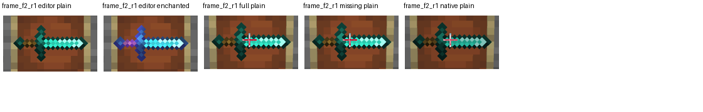
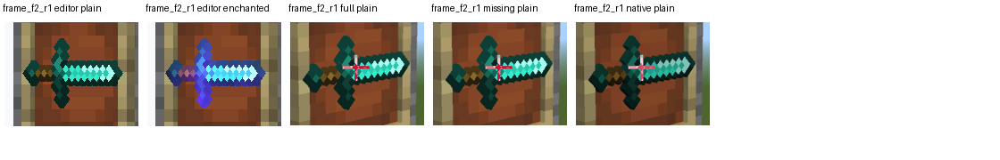
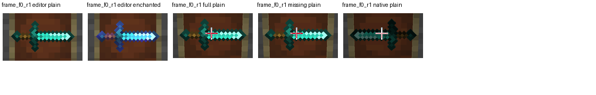

# Item-frame front-plane integration and cold native controls

Production qualification remains **false**. The generated catalog now uses a
front plane of **14.75 model pixels**, integrating the independently isolated
0.25-pixel correction from the previous single-sword experiment. All 450 icon
meshes were regenerated. Size 8.0, extrusion thickness 0.5, bitmap alpha, XY,
UVs, normals, weights, indices, and materials are preserved.

The existing shelf and campfire shader layouts replace mesh Z with 0.3125 and
0.05 respectively; their final local vertices are unchanged. Lectern books use
the separately gated book renderer. `geometry-delta.json` records the comparison
of all 456,704 generated vertices against the pre-change Git source.

| Capture | Item pixels, full / missing / native | Result |
| --- | --- | --- |
| Cold front, north face, 45 degrees | 6,820 / 6,820 / 6,820 | Exact masks; native body and every local edge pass |
| Cold +45-degree side, north face, 45 degrees | 5,817 / 5,817 / 5,817 | Exact masks; visible extrusion and native local edges pass |
| -45-degree side, rotations 0 and 45 | 5,826 / 5,826 / 5,825; 5,786 / 5,786 / 5,786 | Both local native gates pass |
| Other faces, rotation 45 | Upward: 6,373 / 6,373 / 6,374; three walls: 6,820 each | Four poses pass their native/local gates |
| Downward, initial platform | Native item 0 pixels | Invalid oracle; retained as a failure |
| Downward, player below frame, far distance | Native item becomes visible | Fails the unchanged 48-pixel minimum extent |
| Downward, player below frame, near distance | 6,373 / 6,373 / 6,388 in fixed native ROI | Actual direction mismatch; native recall about 0.824, local gate fails |

The downward diagnostic changes only the temporary native test platform:
X moves two blocks outside the camera ray, then Y moves from frameY-1 to
frameY-4. The actual player was above the frame while its detached camera was
below it. Lowering the player restores native item visibility, but exposes a
real remaining pose difference. These captures do not qualify downward poses.
Each completed run restores temporary blocks, inventory, player position,
rotation, projection, blueprint, profile, and environment; source snapshots stay
unchanged and cleanup errors are empty.

The geometry-dependent glint regression passes continuous visible changes in
editor, world, missing-only, and actual native routes. It retains 180 / 77 / 86 /
96 dense frames over 7.897-7.951 seconds, with maximum gaps 0.061 / 0.158 / 0.115 /
0.103 seconds, below the unchanged 0.250-second limit. Plain controls pass and
frozen/empty negative controls are rejected. Bright-area centroid displacement
ratios remain diagnostics and do not establish texture phase-speed parity.





`front/` and `side/` retain all original PNG bytes, sanitized owner-bound WGC
receipts, nested calibration captures, reports, and recomputed analyses.
`source/` freezes the analyzer's actual local import closure, catalog, texture,
sword mesh, generator, shaders, and host tools. Runtime capture authentication
tokens are omitted. Verify byte hashes and independently replay the frozen pixel
analysis with Python, NumPy, and Pillow on Windows:

```powershell
python -B -X utf8 docs/evidence/item-plane-r20-v2/verify_package.py --pixels
```

The verifier rebases retained paths after moving the package. It compares every
measurement with the retained analysis, excluding only report-byte hash and
output-image path, which necessarily change during replay. It does not require
an active game or the original ignored captures. The frozen imports include
Windows capture helpers; this full analyzer replay targets Windows.

`compact/` and `glint/` deliberately retain only review images and metrics.
Their `provenance.json` files give exact original ignored `.runtime/` report,
analysis, and image locations with SHA256 hashes. Those original dense frames
and compact matrix PNGs are local-only; these folders are not standalone pixel
replay packages. The initial blocked-platform capture also remains in
`.runtime/item-r20-faces-v1`, while `downward-empty` preserves the later visible
empty-frame oracle. No missing native image is counted as success.

Validation before this checkpoint: 18 catalog tests, 50 focused pose/plan/native
boundary tests, and the complete 98-test `test_item*.py` suite pass. Generator
`--check`, syntax checks, scoped structural review, and owned diff whitespace
checks pass. This is bounded plane/pose evidence; full 48-pose coverage, selected
glow-frame poses, other icon silhouettes, opacity, occupancy, and lifecycle
acceptance remain independent requirements.
