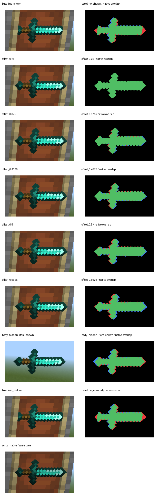

# Item-frame rim clipping and bounded front-plane candidate

Production qualification remains **false**. The valid evidence reproduces the reported 45-degree diamond-sword clipping and isolates frame/body depth as its cause. A front-plane offset of **0.25 model pixels** gives exactly the same item mask as the actual native frame in this fixed north-facing view. Cold candidate front/side verification has not passed: all four recorded attempts failed before obtaining item acceptance pixels.

The generated production catalog and shared meshes remain at front_z_pixels=15.0. Only the owned diagnostic clone's diamond-sword mesh was changed to 14.75. Size 8.0, thickness 0.5, item rotation, camera, and glint were preserved.

| Fixed-pose control | Item pixels | Bounds, exclusive right/bottom | Native local edge result |
| --- | ---: | --- | --- |
| Original plane, frame present | 7,370 | 1553,501,1731,600 | Fails |
| 0.25 pixels forward | 7,804 | 1543,501,1745,601 | Passes; every local recall is 1.0 |
| Actual native frame and inventory sword | 7,804 | 1543,501,1745,601 | Reference |
| Original item, owned body moved away | 7,795 | 1537,501,1741,600 | Both endpoints restored; separate from native pose parity |

The 0.25-pixel mask and native mask are identical, including zero missing native pixels. Removing the owned body restores the full endpoints. Moving that body and the item back restores the baseline with **zero changed pixels**. Offsets 0.5 pixels and greater fail at least one local native edge region and were rejected. This evidence does not accept other faces, oblique thickness, opacity, occupancy, or production admission.



The local gate retains a two-screen-pixel tolerance and minimum local recall 0.985. It measures native terminal strips and fixed native-perimeter tiles, so a small missing sword tip cannot disappear into a whole-body average. Blank controls must fail. The full/missing native routes must both pass separately. Forty focused tests passed for these gates, item masks, and catalog contracts.

| Cold attempt | Result before acceptance | Cleanup |
| --- | --- | --- |
| v1 | Owned MCDK process exited before capture client binding | Both owned processes stopped/absent |
| v2 | New native assertion dialog invalidated the noactivation guard; execute_code was blocked before dispatch | Normal stop failed; identity-bound forced stop completed |
| v3 | Independent stone-camera calibration returned a blank white WGC frame; zero item captures | Camera/fixture restored, source unchanged, empty cleanup errors; normal stop completed |
| v4 | After business readiness plus 30 seconds, three bounded WGC checks 15 seconds apart all returned the same blank white image | Zero acceptance captures; normal stop completed |

The v3/v4 WGC receipts have fresh frame timestamps and unchanged protected foreground snapshots. Their blank images were explicitly rejected. v4 sampled at most 133,577 handles; the ceiling was 250,000. These failures are environment/render-readiness findings and cannot validate or reject the candidate geometry. No activation, resizing, keyboard/mouse injection, or guard bypass was used. Only owned instances were stopped.

`causal/report.json` is sanitized and rebased to this retained package. The analyzer was rerun against it; every measurement agrees with the original after excluding the report-file hash, and the comparison PNG hash is identical. All 13 paired item captures and their receipts are included. `causal/region.png` freezes the source-bound declared ROI for an independent pixel replay. `verify_package.py` verifies every manifest hash and independently recomputes native/offset equality, baseline clipping, isolated-body pixels, local edges, and baseline restoration from those PNGs.

```powershell
python -X utf8 docs/evidence/item-rim-r19-plane-v1/verify_package.py --pixels
```

The independent pixel replay is portable with Python, NumPy, and Pillow. The full original capture/calibration replay is not self-contained: nested historical source/calibration paths still refer to retained local originals. The package preserves capture-time host sources, the exact current analyzer/generator/catalog/texture/mesh, the single changed candidate mesh and original mesh, source snapshots, stage scripts, sanitized failure reports, blank images, and process samples. It omits session authentication tokens and raw startup/stop stdout.
