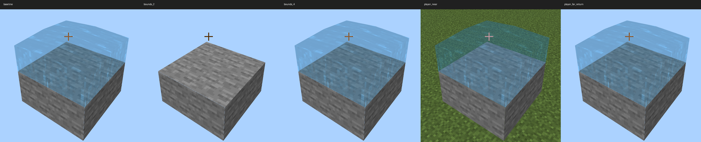

# R18 Product Water Bounds Regression

The reserved world-water fixture is visible at origin `(63, -61, 3)` with the
cold-loaded `ProductWorldLiquidRenderer` default bounding box `(-4, -4, -4)` to
`(4, 4, 4)`. Changing only the live models' bounds to +/-2 removes the water
pixels; restoring +/-4 restores them. This package narrows the distant-world
visibility failure to native FreeModel bounds for this fixture. It does not
admit product water. `PRODUCT_QUALIFIED` remains `False`.

## Evidence And Source Binding

The raw JSON and PNG files are exact native PowerShell `Copy-Item` copies.
Absolute paths inside the raw JSON remain unchanged and may still refer to
the original `.runtime` files. The offline verifier resolves the packaged
copies by their original filenames. No `session.json` or credential token is
included; the launch report was checked for sensitive field names before copy.

| Artifact | Purpose |
| --- | --- |
| `reports/liquid-r18-start-v4.json` | Ready cold-start receipt for the isolated `D:/bbe-r18-water-production` copy; this is a launch-time snapshot, not a stop receipt. |
| `reports/liquid-r18-launch-inputs-v6.json` | Frozen hashes of 3011 source/resource files; source contract `4c2309a150fcffed31a45504ef77c80404e007f698b8857b9a3e0a832af74678`. |
| `reports/liquid-r18-visibility-v4.json` | First diagnostic on this cold-loaded product owner, including its unmodified default +/-4 baseline. |
| `reports/liquid-r18-visibility-v5.json` | Repeat on the same cold-loaded owner with the host diagnostic's fixture-camera restoration after moving the player. |
| `analysis/` | Both original analysis JSON files and contact sheets. |
| `captures/v4/`, `captures/v5/` | All 22 native PNG captures and all 22 external capture receipts from each diagnostic, including hidden controls. |
| `sources/cold_project/` | Exact v6-matching snapshots of the cold copy's diagnostic and six relevant owner/gate modules. |
| `sources/host/tools/diagnose_water_visibility_r18.py` | Exact host tool used for v5, preserved separately from the frozen copy. |
| `manifest.json`, `verification.json`, `verify_package.py` | File hashes/provenance, offline verification results, and the independent receipt/pixel verifier. |

Both reports use session ID `a06f540e21c1466b803d28e2b676a01c`, game PID `19636`
with process identity `134365071897703984`, and the v6 source contract above.
The captured owner types are `ProductLiquidProjection` and
`ProductWorldLiquidRenderer`. The initial owner has eight active models, zero
staging models, and zero retired models. At the baseline the player foot is
`(0.5, -60, 0.5)`, the camera is `(69.5, -55, 10.5)`, and entity render distance
is `256`.

The first v4 phase runs before the script calls any live bounds setter, so its
visible baseline validates the cold product default +/-4. V5 is a repeat on
the same running code, not another independent cold start. Every tested cold
source snapshot in this package matches its entry in v6.

| Diagnostic Tool | SHA-256 |
| --- | --- |
| Frozen copy, also used for v4 | `53f54794e524368441723360819a93c3df6e3e20b067a302e9031a71ad090076` |
| Host tool used for v5 | `0b7d71b03c80281dc26c484d2644f1599cd970a0046fc5eb1fffd5b3723a3815` |

The isolated project remains on the v6 source snapshot, including the older
diagnostic SHA. V5 ran the host tool against that copy. The tool difference is
one camera-restoration helper plus calls after the near and far player moves;
it does not change the behavior/resource-pack source or bounds policy.

## Observed Results

Each row compares a wet capture with the same phase's hidden-water control.
The declared ROI is `(700, 430, 1300, 1000)` in native pixels. A changed pixel
has a maximum absolute RGB channel difference greater than `3`. The values
below were independently recomputed from the archived PNGs.

| Phase | V4 Changed Pixels | V5 Changed Pixels |
| --- | ---: | ---: |
| Initial product default +/-4 | 117941 | 117941 |
| Live bounds +/-2 | 0 | 0 |
| Live bounds +/-4 | 117941 | 117941 |
| Live bounds +/-8, +/-16, +/-32, +/-64 (each) | 117941 | 117941 |
| Explicit large bounds +/-64 | 117941 | 117941 |
| Entity distance 1024 with large bounds | 117941 | 117941 |
| Player moved near, after restoring default bounds and distance | 4744 | 117941 |
| Player returned to original foot position | 0 | 117941 |

V4's near/return phases changed camera rotation from approximately
`(26.565, -36.870, 0)` to `(0, 179.995, 0)` while retaining camera position.
Those two pixel counts are retained as raw evidence and do not establish a
water-visibility regression during travel. V5 restores the original fixture
camera after each player move; camera position and rotation match before and
after every capture pair. The water remains visible in both v5 travel phases.

The entity-distance control follows the live bounds expansion. It does not
independently show that entity render distance caused or fixed the problem.
The controlled +/-2 versus +/-4 pair is the evidence for the bounds conclusion.



The contact sheet shows continuous top and side outlines in this fixture and
visible stone through the water. It does not replace the separate side-UV,
transparency, animation, neighbor, or tint acceptance matrices.

## Integrity And Cleanup

Both runs report `completed=true`, `restored=true`, `source_unchanged=true`,
`product_admission_performed=false`, and no cleanup errors. Each owner cleanup
receipt has `closed=true`, `renderer_closed=true`, and active/staging/retired
counts all zero. These are projection-resource cleanup results, not a claim
that the launch-time game process has subsequently been stopped.

All 44 capture receipts match their report's embedded receipts. Their PNG
hashes, byte counts, native dimensions, owner, game PID and process identity
verify. All receipts report guarded no-activation capture, no activation
fallback, `agent_activation_allowed=false`, unchanged foreground during the
capture, and `background_safe=true`. User foreground activity was allowed by
the recorded policy. The WGC helper SHA is
`cb9122a6713e9c627ee9ea7658e7610e7f72d7b451412b0c6331a5bb1fbcb5a8`.

Run the offline verification from the repository root:

```powershell
python docs/evidence/liquid-owner-r18-bounds-v1/verify_package.py --pixels
```

`--pixels` requires Pillow. Without it, receipt, source-contract, manifest,
PNG, gate, identity and cleanup checks still run using the Python standard
library. The manifest hashes every packaged file except the manifest itself.
`verification.json` preserves the independently recomputed ROI metrics.

## Qualification Remains Open

The earlier mixed-copy `b.project()` list-assignment failure did not recur
after the complete Python closure was synchronized. No full traceback
identified that original failure's cause, so the controlled success does not
establish a general fix. The diagnostic explicitly assigns a candidate liquid
profile and reserved fixture before calling `b.project()`; it does not qualify
the closed production-default entry.

The full editor/full-world/missing-world cold-start matrix, default product
path, biome tint return, flow/animation burst, side UV, opaque side and reverse
neighbor controls, occupancy/lifecycle matrix, 100 ms cold-build budget, public
gallery, and final shared-entry source/resource contract remain outside this
package's acceptance claim. The archived qualification module has
`PRODUCT_QUALIFIED = False`; no production gate is promoted.

Subsequent frozen matrix evidence and remaining failures are preserved in
`../liquid-owner-r18-matrix-v1/README.md`. After those restored tests, this
session's game PID 19636 and MCDK PID 52380 were force-stopped and confirmed
exited; the narrow diagnostic's resource-cleanup records remain unchanged.
