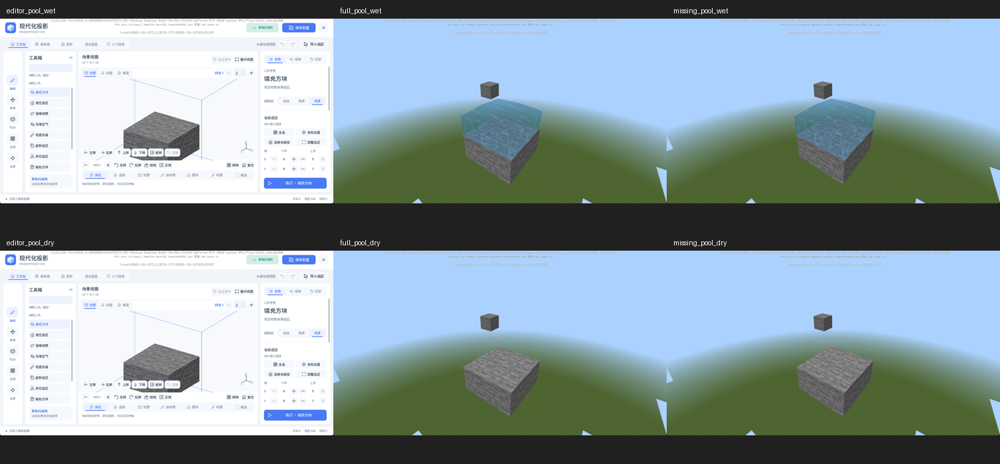

# R18 Frozen Water Matrix Checkpoint

The frozen public matrix was captured through editor, full projection, and
missing projection, but it did not pass product acceptance. The new blocking
result is that editor water has no independently visible pixels despite ready
plans and visible renderer banks. World-side UV correlation also remains below
the declared threshold. `PRODUCT_QUALIFIED` remains `False`.

| Report | Public Cases | Route-Case Pairs | Rows | Captures | Completed / Restored / Source Unchanged |
| --- | ---: | ---: | ---: | ---: | --- |
| `liquid-r18-core-v1` | 9 | 27 | 66 | 144 | true / true / true |
| `liquid-r18-neighbors-v1` | 10 | 30 | 96 | 204 | true / true / true |
| Total | 19 | 57 | 162 | 348 | No cleanup errors |

The two reports cover all 19 public cases across all three routes without
duplicating any route-case pair. This is capture coverage, not a passing
qualification matrix. Neither report is a production-default test: both
explicitly assign the frozen candidate profile.

## Reproducible Failures

The pool comparison below shows wet captures above dry captures, with editor,
full projection, and missing projection from left to right.



All nine core editor wet cases fail independent water visibility. The eight
core geometry cases have observed water-mask pixels equal to zero. Editor
fence transparency and fixed alpha controls also fail because eligible water
pixels are zero. The ten-case supplement repeats the editor failure: seven
geometry checks and nine applicable visibility checks fail. Three additional
editor alpha-control families also have no eligible water pixels.

For `editor_pool_wet`, readback reports `enabled=true`, `owned=true`,
`plan_ready=true`, `controls_pending=false`, no liquid error, and eight groups.
Each mounted group records bank visibility `[false, true]`, a ready request
using `modern_projection_liquid_product_*_frozen`, and opacity `1`. This narrows
the next diagnostic to actual PaperDoll model IDs, native visibility, depth,
and layout. It does not establish which of these causes the absent pixels.
The representative PNG visibly contains the stone fixture without water.

Full and missing projection pass their core and supplement geometry, alpha,
and applicable visibility checks. Both world routes still fail pool side UV:

| Side | Correlation | Required | RGB RMSE | Required |
| --- | ---: | ---: | ---: | ---: |
| South | 0.814256 | >= 0.85 | 5.843285 | <= 8 |
| East | 0.682708 | >= 0.85 | 7.470552 | <= 8 |

The independent opaque controls are preserved. These numerical failures do
not by themselves establish a visible geometric crack or seam. No threshold
or analyzer was changed to make them pass.

All four measured owner methods pass the existing CPU limits in each report.
The core maxima are Controls 9 ms, Projection 42 ms, Preview 6 ms, and World
Renderer 40 ms. The measurement excludes host IPC and capture time. The
maximum observed water groups is eight; this is not a configured-capacity
stress test. All 44 core and 64 supplement lifecycle stop readbacks pass.

## Preserved Artifacts

`reports/` contains exact source reports, both original geometry/transparency
analyses and acceptance analyses, the same-session stone camera calibration,
the v6 launch snapshot, and launch/stop receipts. The calibration passed all
three stone views, restored all state, and fit an effective vertical FOV of
66.5 degrees at native 1994 x 1105 pixels.

Eight independent capture ZIPs preserve all 348 exact PNGs and all 348 external
receipts; the raw reports also embed every receipt. Each archive is below
48,000,000 bytes, including ZIP metadata. `capture-index.json` maps each original label
to its archive, member, byte count, and hash. Raw reports retain their original
absolute runtime paths. All pixels remain available in these archives if
those runtime files are later removed.

| Archive | Bytes |
| --- | ---: |
| `captures-core-editor.zip` | 11678499 |
| `captures-core-full.zip` | 45685740 |
| `captures-core-missing.zip` | 45686605 |
| `captures-neighbors-editor.zip` | 16326040 |
| `captures-neighbors-full-01.zip` | 31957117 |
| `captures-neighbors-full-02.zip` | 21628319 |
| `captures-neighbors-missing-01.zip` | 31967073 |
| `captures-neighbors-missing-02.zip` | 21628699 |

The original 227751122-byte combined archive is retained outside the package
at ignored `.runtime/liquid-r18-large-captures-original.zip`, SHA-256
`7df935c2a121792b4ec206ef1fac26b8ecb733378fa5675a2a6c4242893afed5`.
`migration-verification.json` compares every original archive member with the
eight new archives byte for byte. The package verifier additionally rejects
oversized capture archives, missing or duplicate PNG/receipt members, and
external receipts that disagree with embedded report fields.

`launch-inputs.zip` preserves all 3011 files from the unchanged cold copy.
The archived bytes match v6 source contract
`4c2309a150fcffed31a45504ef77c80404e007f698b8857b9a3e0a832af74678`.
`archived-launch.json` was generated after testing to preserve those same
bytes; it does not describe a second game launch.

All 348 PNG hashes, dimensions, byte counts, and guarded no-activation receipt
fields verify. All receipts have `reliable=true`, `background_safe=true`,
`agent_activation_allowed=false`, and `activation_fallback=false`. In 41
captures the foreground window changed while policy allowed user foreground
activity. These rows are listed in `verification.json`; the package does not
claim unchanged foreground for those captures or infer the source of the
window change. The launch used the native no-activation guard and no desktop
input or resize was issued by this test runner.

Session `a06f540e21c1466b803d28e2b676a01c` used game PID 19636 and MCDK PID
52380 on port 19364. Both processes were force-stopped after the restored
matrix, and a process lookup confirmed both exited. This owner left no
running test instance.

Run the archive verifier from the repository root:

```powershell
python docs/evidence/liquid-owner-r18-matrix-v1/verify_package.py
```

## Next Fixed Checks

1. Diagnose one editor pool/source positive control: actual native model ID,
   visible control chain, render depth, and affine placement. Capture a
   matched negative control before rerunning the 19-case editor matrix.
2. Diagnose the opaque side UV correlation failures against the preserved
   physical sample grid; retain the existing thresholds and negative controls.
3. Run frozen biome tint return and missing-pool occupancy mutation/restore in
   all routes using `--frozen --extras --controls wet` and cases
   `wet_oak_fence`, `pool`.
4. Run animated `flow_east`, `flow_south`, `flow_west`, `flow_north`, `falling`
   in all routes with `--extras --controls wet` and the pinned burst helper.
5. Run reverse-view `neighbor_oak_slab`, `neighbor_oak_stairs`,
   `neighbor_glass_pane`, `neighbor_stone`, `transparent_overlap` in all routes.
6. Run the public `gallery` in the editor at the declared 0.9 zoom.
7. Only after candidate evidence passes, perform a separately authorized
   isolated default-entry admission and a new cold-start default report.
   The current closed production gate deliberately prevents that report.
8. Rebind all acceptance to the final source/resource contract and inspect
   the evidence before any production gate change.

Items 3-6 were not rerun in this checkpoint. The existing probe and analyzers
can be reused; preserved frozen captures and launch bytes remain useful for
offline diagnosis. There is no supported remaining-hours estimate from this
checkpoint.

## Archive size maintenance (2026-10-17)

The two oversized neighbor capture ZIPs were split into independent numbered ZIPs. Each PNG remains beside its original receipt, and all 696 original members were compared byte for byte against the retained combined archive. This changes packaging only; the recorded product failures and acceptance thresholds are unchanged. No Git LFS is required. The verifier enforces a 48,000,000-byte limit and the archive commands split oversized capture sets automatically.
